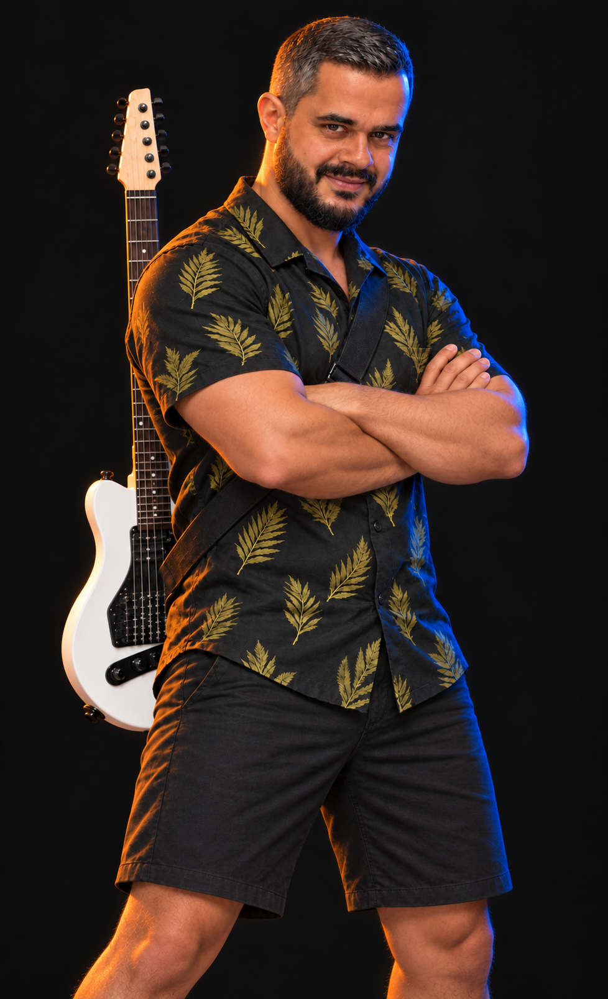
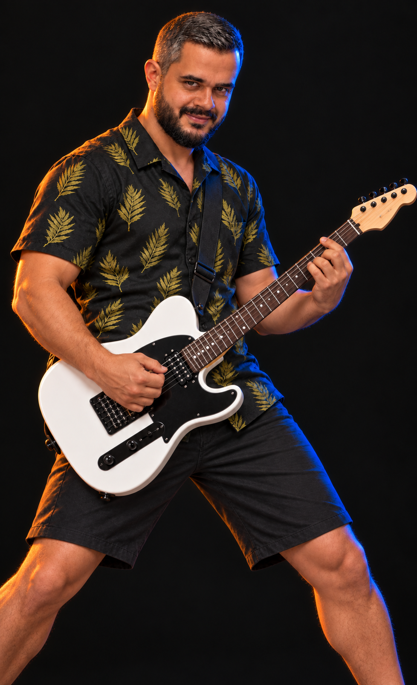
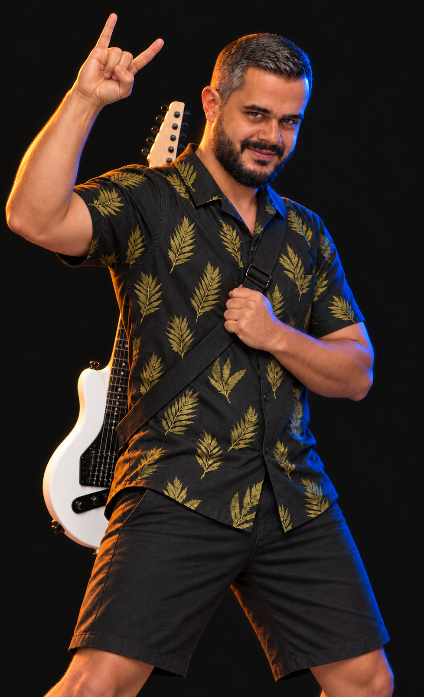

# Dodo victory options

Created with built-in imagegen. Preview options only; not applied to the game.

## Option 1

Use case: identity-preserve. Create a NEW victory portrait for a fighting game's winner screen, using the reference as the exact identity, outfit, photographic style and lighting reference. Dodo: same face, short salt-and-pepper hair, dark beard, natural body proportions with long torso. Black short-sleeved button-up with olive gold leaf print, black shorts, same white Telecaster-style electric guitar and black strap. Photoreal cinematic studio portrait with warm orange rim light on image-left and electric blue rim light on image-right. Natural clean skin with subtle real pores, NO cracked, polygonal, scaly, embossed or gritty skin texture. Vertical portrait from entire head to just above knees, complete hands with space around silhouette. Single man, no text, no UI, no collage, plain near-black background. One guitar only, anatomically correct hands. OPTION 1 — Quiet champion. Standing tall in a relaxed three-quarter stance, both arms crossed confidently across his chest, shoulders relaxed, chin slightly down, looking directly at camera with subtle closed-mouth confident smirk. Guitar remains strapped behind his back, white body visible beside hip and upright neck over shoulder. Strong composed winner attitude.

## Option 2

Use case: identity-preserve. Create a NEW victory portrait for a fighting game's winner screen, using the reference as the exact identity, outfit, photographic style and lighting reference. Dodo: same face, short salt-and-pepper hair, dark beard, natural body proportions with long torso. Black short-sleeved button-up with olive gold leaf print, black shorts, same white Telecaster-style electric guitar and black strap. Photoreal cinematic studio portrait with warm orange rim light on image-left and electric blue rim light on image-right. Natural clean skin with subtle real pores, NO cracked, polygonal, scaly, embossed or gritty skin texture. Vertical portrait from entire head to just above knees, complete hands with space around silhouette. Single man, no text, no UI, no collage, plain near-black background. One guitar only, anatomically correct hands. OPTION 2 — Victory encore. Guitar now worn in front at waist in a natural playing position, left hand fretting on the neck and right hand completing a triumphant strum over the strings. Torso slightly angled, face turned to camera with a subtle satisfied smile, grounded wide stance. Looks like a musician celebrating a win with a final chord, not using guitar as weapon. Entire guitar body and headstock in frame.

## Option 3

Use case: identity-preserve. Create a NEW victory portrait for a fighting game's winner screen, using the reference as the exact identity, outfit, photographic style and lighting reference. Dodo: same face, short salt-and-pepper hair, dark beard, natural body proportions with long torso. Black short-sleeved button-up with olive gold leaf print, black shorts, same white Telecaster-style electric guitar and black strap. Photoreal cinematic studio portrait with warm orange rim light on image-left and electric blue rim light on image-right. Natural clean skin with subtle real pores, NO cracked, polygonal, scaly, embossed or gritty skin texture. Vertical portrait from entire head to just above knees, complete hands with space around silhouette. Single man, no text, no UI, no collage, plain near-black background. One guitar only, anatomically correct hands. OPTION 3 — Rock salute. Guitar strapped securely behind his back with body at hip and neck over shoulder. One hand raised beside and slightly above his head making a clear rock horns gesture (index and little finger extended, middle and ring folded under thumb), other hand casually gripping the guitar strap at chest. Slight lean and confident closed-mouth grin, gaze at camera. Natural celebratory energy, not a raised fist pose.

